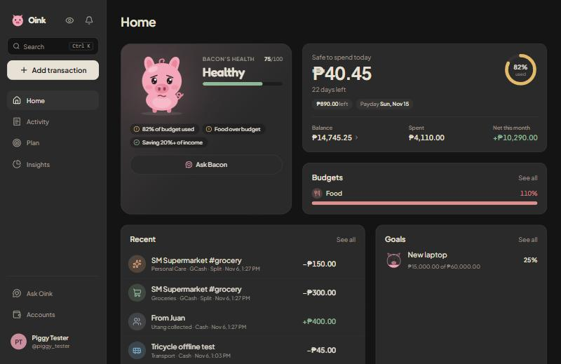
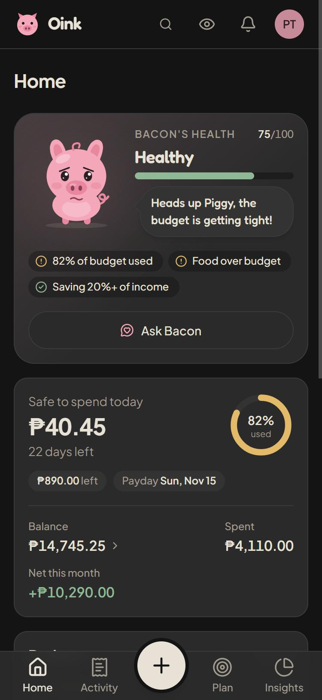
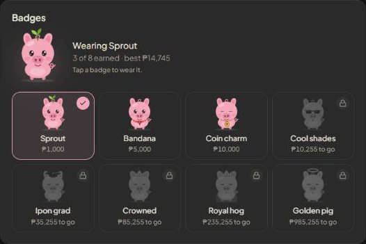
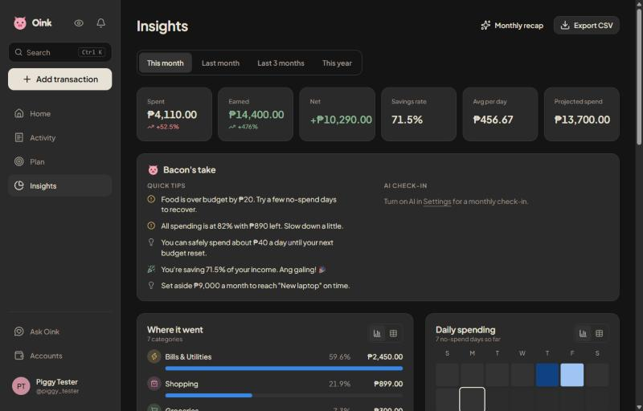

# Oink 🐷

Expense and budget tracker for the Philippines, with a pig that gets chubby when your money is healthy and thin when it isn't.

[](https://github.com/retsu14/expense-tracker/actions/workflows/ci.yml)

<p align="center">
  
  
</p>

## Features

- **Track money** — expenses, income and transfers across wallets (cash, GCash, Maya, banks). Split a purchase across categories, tag entries, edit in bulk, undo deletes.
- **Type it** — write `lunch 150 gcash yesterday` and the form fills itself.
- **Plan** — monthly or pay-cycle budgets with a safe-to-spend-per-day figure, bills and subscriptions with reminders, savings goals, and utang (money lent or borrowed).
- **Insights** — spending by category, trends, a daily heatmap, a 30-day cash-flow forecast, a monthly recap you can share, and CSV/JSON export.
- **The pig** — a health score from your budgets, balance, bills and debts. It reacts to taps, follows your cursor and talks.
- **Pig badges** — reach a total balance of ₱1k, ₱5k, ₱10k, ₱25k, ₱50k, ₱100k, ₱250k and ₱1M to unlock a sprout, bandana, coin charm, shades, grad cap, crown, royal cape and finally a golden pig. Each unlock plays a short celebration, every item has its own idle motion and tap trick, and badges are kept even if your balance drops later.
- **Optional local AI** — chat about your money and get monthly check-ins, running in your browser (WebLLM) or through [Ollama](https://ollama.com). Nothing leaves your device.
- **Works like an app** — installable PWA, logs offline and syncs later, optional PIN lock, dark and light themes, usable down to 320px screens.

<p align="center">
  
  
  
  
  <br />
  <sub>Thriving · Healthy · Getting thin · Starving</sub>
</p>

<p align="center">
  
  <br />
  <sub>Badges in Settings: tap an earned one to dress up your pig</sub>
</p>

<p align="center">
  
</p>

## Tech stack

| Area    | Tools                                                                  |
| ------- | ---------------------------------------------------------------------- |
| App     | Next.js 16 (App Router, server actions), React 19, TypeScript (strict) |
| UI      | Tailwind CSS 4, Radix UI, Motion, Recharts, vaul, sonner, Zustand      |
| Data    | Neon Postgres, Drizzle ORM (SQL migrations in `drizzle/`)              |
| Storage | Cloudflare R2 for avatars (server-side only, private bucket)           |
| Auth    | Username + password (Argon2id), one-time recovery codes, no email      |
| AI      | WebLLM (WebGPU) or Ollama, both optional                               |
| Quality | Vitest, Playwright + axe, ESLint, Prettier, Husky, commitlint          |

## Getting started

### Requirements

- Node.js **24.14** (see `.nvmrc`)
- A [Neon](https://neon.tech) Postgres database
- A [Cloudflare R2](https://developers.cloudflare.com/r2/) bucket and an API token with read/write access
- Docker (optional, for the dev container)

### 1. Configure

```bash
cp .env.example .env.local
```

| Variable               | Required | Description                                             |
| ---------------------- | -------- | ------------------------------------------------------- |
| `DATABASE_URL`         | Yes      | Neon connection string (`?sslmode=require`)             |
| `R2_ACCOUNT_ID`        | Yes      | Cloudflare account ID                                   |
| `R2_ACCESS_KEY_ID`     | Yes      | R2 API token access key                                 |
| `R2_SECRET_ACCESS_KEY` | Yes      | R2 API token secret                                     |
| `R2_BUCKET`            | Yes      | Bucket name for avatars                                 |
| `APP_URL`              | No       | Public URL of the app (default `http://localhost:3000`) |

The bucket can stay private and needs no CORS rules: uploads and downloads go through the app.

### 2. Install and migrate

```bash
npm install
```

```bash
npm run db:migrate
```

### 3. Run

With Docker (hot reload, uses `.env.local`):

```bash
docker compose up
```

Or directly:

```bash
npm run dev
```

Open http://localhost:3000, create an account and follow the short setup.

## Scripts

| Command               | What it does                                 |
| --------------------- | -------------------------------------------- |
| `npm run dev`         | Start the dev server                         |
| `npm run build`       | Production build                             |
| `npm start`           | Serve the production build                   |
| `npm run check`       | Typecheck, lint, format check and unit tests |
| `npm test`            | Unit tests (Vitest)                          |
| `npm run e2e`         | End-to-end tests (Playwright)                |
| `npm run db:generate` | Create a migration from schema changes       |
| `npm run db:migrate`  | Apply migrations                             |
| `npm run db:studio`   | Browse the database                          |
| `npm run icons`       | Regenerate PWA icons                         |

## Testing

Unit tests cover the domain logic (budgets, forecasts, the entry parser, pig health, badges and more):

```bash
npm test
```

End-to-end tests register a throwaway user, run the main flows (onboarding, quick entry, budgets, search, export) and check accessibility with axe on desktop and a 320px phone. The test user is deleted afterwards. They use your installed Chrome and run best against a production build:

```bash
npm run build && npx next start -p 3100
```

```bash
E2E_BASE_URL=http://localhost:3100 npm run e2e
```

## Optional local AI

Turn it on in **Settings → AI**.

- **This browser** — downloads a small model once (270 MB–2.2 GB) and runs it with WebGPU. Needs a recent Chrome, Edge or Safari. GPUs without 16-bit shader support get a compatible build automatically.
- **Ollama** — install [Ollama](https://ollama.com/download), then download a model from Settings. Ollama allows `localhost` by default. For a deployed site, allow its origin and restart Ollama:

  ```bash
  OLLAMA_ORIGINS=https://your-domain.com ollama serve
  ```

The AI only sees computed totals (budgets, bills, goals, balances), never raw transactions.

## Project structure

Domain-driven layout. Each module keeps its business rules free of framework code; ESLint enforces the layer boundaries.

```
src/
├── app/                 Routes, layouts, API route handlers
├── components/          UI (pig, layout, forms, charts, ui primitives)
├── modules/
│   ├── identity/        Accounts, sessions, recovery codes, avatars
│   ├── ledger/          Wallets, categories, transactions, CSV import
│   ├── planning/        Budgets, bills, goals, debts, notifications
│   ├── analytics/       Insights, forecast, recap, export
│   ├── assistant/       Entry parser, AI prompts, WebLLM/Ollama adapters
│   └── mascot/          Pig mood, health scoring and balance badges
│       └── <module>/{domain, application, infrastructure, presentation}
├── shared/              DB client, env, storage, kernel (money, time, result)
├── stores/              Zustand stores
└── proxy.ts             Auth redirects and per-request CSP nonce
e2e/                     Playwright tests
drizzle/                 SQL migrations
```

## Deployment

**Vercel** — import the repo, add the environment variables above, then run migrations against the production database. No extra build settings are needed.

**Search and sharing** — signed-out visitors get a landing page at `/` with Open Graph images, JSON-LD (app, organization and FAQ), `sitemap.xml`, `robots.txt`, and `llms.txt` / `llms-full.txt` for AI search. Set `APP_URL` to your public domain so all of these use it (on Vercel it falls back to the production domain).

**Docker** — the `production` stage builds a standalone server:

```bash
docker build --target production -t oink .
```

```bash
docker run -p 3000:3000 --env-file .env.local oink
```

## Security

- Argon2id password hashing, rate-limited sign-in and recovery, sign out other devices
- Strict Content Security Policy with per-request nonces, HSTS and frame blocking
- Every query is scoped to the signed-in user
- Avatars are type-checked by file signature, limited to 2 MB and stored in a private bucket

## Contributing

Branch from `development`, keep `npm run check` green and use [Conventional Commits](https://www.conventionalcommits.org) (enforced on commit).
